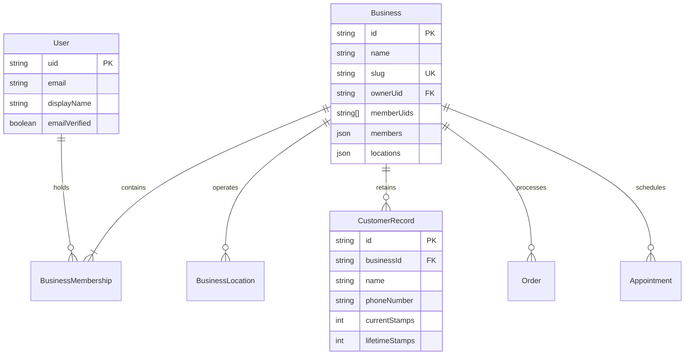
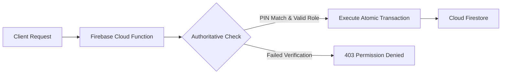

# FIREBASE MIGRATION READINESS & BACKEND ARCHITECTURE REPORT
**Project:** Loyaltydigitalqr  
**Audit Scope:** Cloud Firestore, Firebase Auth, Cloud Functions & Production Infrastructure Assessment  
**Auditor:** Senior Principal Cloud Architect & Application Security Reviewer (Antigravity Autonomous Pair Programmer)  
**Date of Audit:** October 31, 2026  
**Deliverable Path:** `audit/independent-readonly-audit/FIREBASE_READINESS_REPORT.md`  

---

## 1. Executive Assessment: Is the Application Firebase-Ready?

### Official Verdict: **CONDITIONALLY READY FOR PRODUCTION BACKEND WIRING**

The codebase has already completed significant architectural preparation for Firebase:
1. **Firebase SDK & Bootstrapping:** Fully wired in `src/lib/firebase.ts` with Vite environment variables (`VITE_FIREBASE_*`).
2. **Authentication Flow:** Migrated to real Firebase Auth (`signInWithPopup`, `signInWithEmailAndPassword`, `createUserWithEmailAndPassword`, `sendEmailVerification`). Email verification gating is active on Onboarding, Dashboard, and KDS.
3. **Firestore Security Rules:** A production-grade `firestore.rules` file (324 lines) exists in the repository root, enforcing multi-tenant business membership scoping, role-based configuration boundaries (Manager vs Staff), unguessable token lookups, and customer self-enrollment batch validation.
4. **Reactive Sync Architecture:** `bizStore.ts` provides a live reactive caching layer on top of Firestore `onSnapshot` listeners and chunked batch commits.

### Why It Is Only *Conditionally* Ready (Blockers to Overcome Before Paying Clients):
- **Missing Cloud Functions Layer:** All mutations (pricing, totals, stamps, balances) are executed directly from client browsers. There is zero server-side authoritative validation.
- **Plaintext Staff Counter PIN Storage:** Staff PINs are stored unhashed on the `businesses/{bizId}` document, exposing counter secrets to all workspace members in browser memory.
- **Client-Side Pricing & Concurrency:** Order pricing and salon slot availability are evaluated client-side. Two users booking the same salon slot will double-book without a server-side Firestore Transaction.
- **Billing & SMS Messaging Are Simulated:** No Stripe / Razorpay webhook exists; win-back campaigns export CSVs rather than sending real SMS/email.

---

## 2. Authentication & Multi-Tenant Membership Model

The platform implements a **Membership Document Model** where a Firebase Authentication UID represents a human user, while a Business represents an isolated tenant workspace.

### Key Principles of the Model:
1. **One User, Multiple Workspaces:** A user can own one business (e.g. Coffee Shop) while being a staff member of another (e.g. Barbershop).
2. **Email Verification Gated:** Email/password accounts must verify their email address before creating a workspace or accepting team invitations. Google OAuth accounts arrive pre-verified.
3. **Team Invitations via Collection-Group Query:** Invites are written to `/businesses/{bizId}/invites/{email}`. When a user logs in, `businessService.refreshInvites()` executes a collection-group query `query(collectionGroup(db, 'invites'), where('email', '==', user.email))` to display pending invitations.

---

## 3. Production Cloud Firestore Schema Recommendation

To ensure strict multi-tenant isolation, query efficiency, and minimal read costs, the Firestore collection hierarchy is organized into top-level lookups and business-scoped subcollections:

### A. Root Collections
| Collection Path | Purpose | Access Control (Firestore Rules) |
| :--- | :--- | :--- |
| `/users/{uid}` | User account metadata & last sign-in timestamp | Authenticated user (`request.auth.uid == uid`) |
| `/slugs/{slug}` | Unique mapping: public slug -> `businessId` | Public get; Create/delete by business members |
| `/publicProfiles/{bizId}` | Public branding, logo, colors, and locations (no PINs/emails) | Public get; Write by business managers |
| `/businesses/{bizId}` | Private workspace root, memberships, locations, plan status | Members only (`request.auth.uid in resource.data.memberUids`) |

### B. Business-Scoped Subcollections (`/businesses/{bizId}/*`)
| Subcollection | Document Purpose | Access Requirement | Sensitive Fields Requiring Redaction |
| :--- | :--- | :--- | :--- |
| `config/loyaltyProgram` | Single loyalty rule definition | Public get; Managers write | None (displayed on card) |
| `customers/{id}` | Full customer CRM record | Members read/write; Visitor self-enroll | Redact notes & phone on public card |
| `customerPhones/{phoneKey}`| Phone uniqueness reservation index | Members read/write; Visitor create-only | Exposes only `{ customerId }` |
| `memberCards/{id}` | Public projection of customer card | Public get by unguessable ID | Contains only firstName & stamps |
| `loyaltyEvents/{id}` | Immutable audit log of visits & redemptions | Members read; Immutable event append | Internal staff identifiers |
| `qrCodes/{id}` | Saved counter QR standee definitions | Members read; Managers write | None |
| `menus/{id}` | Menu versions and publish status | Public read; Managers write | None |
| `menuCategories/{id}` | Menu category groupings | Public read; Managers write | None |
| `menuItems/{id}` | Dish/drink items, prices, dietary tags | Public read; Managers write | None |
| `tables/{id}` | Dining tables and QR standee links | Public read; Managers write | None |
| `orders/{id}` | Live customer orders and status history | Public get by 32-char ID; Members full queue | Customer phone & delivery notes |
| `salonServices/{id}` | Salon service catalogue and durations | Public read; Managers write | None |
| `salonStaff/{id}` | Stylist profiles, active days, hours | Public read; Managers write | Private phone numbers |
| `appointments/{id}` | Bookings with client contact info | Public get by 32-char ID; Members full calendar | Client email, phone, internal notes |
| `appointmentSlots/{id}` | Public slot projection (times only) | Public read; Public/Member write | Projects only startIso, endIso, duration |
| `retailCategories/{id}`| Retail boutique categories | Public read; Managers write | None |
| `retailProducts/{id}` | Product inventory, SKUs, variants | Public read; Managers write | Supplier cost/margins |
| `retailPurchases/{id}` | In-store recorded transactions | Members read/write | Customer transaction totals |
| `gymPlans/{id}` | Monthly/annual membership plans | Members read; Managers write | None |
| `gymMembers/{id}` | Member profiles & remaining passes | Members read/write | Emergency contact info |
| `gymCheckIns/{id}` | Member visit audit records | Members read/write | None |
| `gymClasses/{id}` | Studio class schedules & capacity | Members read/write | Enrolled member rosters |
| `carwashServices/{id}` | Wash packages & pricing | Members read; Managers write | None |
| `carwashBundles/{id}` | Prepaid multi-wash pass definitions | Members read; Managers write | None |
| `carwashPasses/{id}` | Customer vehicle passes & balances | Members read/write | License plate & owner name |
| `carwashVisits/{id}` | Tunnel check-in redemptions | Members read/write | None |
| `serviceItems/{id}` | Generic repair & trade rate cards | Members read; Managers write | None |
| `serviceJobs/{id}` | Service job tickets and billing | Members read/write | Customer contact & bill amounts |
| `offers/{id}` | Promotional discount campaigns | Members read; Managers write | None |
| `offerRedemptions/{id}`| Record of applied promotions | Members read/write | Discount amounts saved |
| `segments/{id}` | Customer audience definitions | Members read; Managers write | Customer filter criteria |
| `campaignRuns/{id}` | Historical campaign simulation logs | Members read; Managers write | Audience size counts |
| `feedbacks/{id}` | Customer reviews & ratings | Members read/write; Visitor create | Customer email & review comments |
| `invites/{email}` | Pending team member invitations | Managers write; Invitee get/delete | Target role & inviter name |

---

## 4. Trusted Backend Operations (Cloud Functions Requirements)

The following operations **must not be entrusted to client-side code**:

1. **`issueLoyaltyStamp`:**  
   - *Current Implementation:* Client validates staff PIN and writes updated `currentStamps` and `loyaltyEvents`.  
   - *Risk:* Any member can directly write `currentStamps: 9999` via DevTools.  
   - *Requirement:* Server-side Cloud Function verifying caller authentication, comparing hashed PIN with constant-time equality, and committing an atomic transaction.
2. **`redeemRewardVoucher`:**  
   - *Current Implementation:* Client marks `reward.isRedeemed = true`.  
   - *Risk:* Replay attacks or un-redeeming vouchers by modifying Firestore documents.  
   - *Requirement:* Server-side transaction ensuring voucher is active and burning it atomically.
3. **`createOrder`:**  
   - *Current Implementation:* Browser calculates item prices, variant adjustments, and subtotal.  
   - *Risk:* Price tampering by malicious guests submitting zero or negative totals.  
   - *Requirement:* Function re-computes line totals from authoritative `menuItems/{id}.price` before persisting order.
4. **`bookAppointmentSlot`:**  
   - *Current Implementation:* Browser checks free intervals against cached appointments.  
   - *Risk:* Race condition where two concurrent users book the same time slot.  
   - *Requirement:* Server transaction asserting slot availability and writing `appointments` and `appointmentSlots` in a single ACID commit.
5. **`processSubscriptionWebhook`:**  
   - *Current Implementation:* Client displays static 30-day countdown based on `createdAt`.  
   - *Requirement:* Stripe/Razorpay webhook Cloud Function updating `businesses/{bizId}.planStatus` and `planExpiresAt`.

---

## 5. Firebase Quota, Billing Plan & Infrastructure Limitations

Deploying Loyaltydigitalqr requires an accurate understanding of Firebase billing plans:

### Spark (Free) Plan vs Blaze (Pay-as-you-go) Plan:
| Capability / Service | Spark (Free) Plan | Blaze (Pay-as-you-go) Plan | Project Impact |
| :--- | :--- | :--- | :--- |
| **Cloud Functions** | **NOT AVAILABLE** (Node 10+ requires Blaze) | Full Support | **BLAZE PLAN MANDATORY**: Cloud Functions cannot be deployed on Spark. |
| **Outbound Network Requests** | Blocked (Google APIs only) | Unrestricted | Calling external payment gateways (Stripe/Razorpay) or SMS providers (Twilio) requires Blaze. |
| **Cloud Firestore Reads** | 50,000 / day | $0.06 per 100k reads | `bizStore` collection listeners on high-volume accounts will exceed Spark limits quickly. |
| **Cloud Firestore Writes** | 20,000 / day | $0.18 per 100k writes | Ample for pilot phase; scale requires Blaze. |
| **Firebase Auth** | 50k monthly active users | Free up to 50k MAU | Ample for initial clients. |
| **Cloudflare R2 Storage** | 10 GB free tier / month | $0.015 / GB-month | Independent of Firebase; zero egress fees. |

**Architectural Takeaway:** Loyaltydigitalqr **cannot launch on the free Spark plan**. Enabling Cloud Functions and outbound payment/SMS integrations requires upgrading the Firebase project `loyaltydigitalqr` to the **Blaze (pay-as-you-go)** plan.

---

## 6. Recommended Five-Phase Migration Roadmap Evaluation

The original project specification envisioned a five-phase Firebase migration. Based on the actual state of the codebase, that distribution has been evaluated and refined:

| Phase | Stated Goal | Codebase Reality & Actual Readiness | Recommended Execution Priority |
| :--- | :--- | :--- | :---: |
| **Phase 1: Foundation** | SDK setup, env config, R2 worker | **ALREADY IMPLEMENTED** in commits `a53cbfe` and `893e6c2`. | Verified & Complete |
| **Phase 2: Auth & Tenancy** | Firebase Auth, workspace creation, invites | **ALREADY IMPLEMENTED** in commit `f972b37`. Email verification gating active. | Verified & Complete |
| **Phase 3: Core Data & CRM**| Firestore services, public pages, loyalty | **ALREADY IMPLEMENTED** in commit `d9be318`. `bizStore` provides live sync. | Verified & Complete |
| **Phase 4: Vertical Hardening**| Industry modules, truthful analytics | **ALREADY IMPLEMENTED** in commit `a73987c`. Fake metrics removed. | Verified & Complete |
| **Phase 5: Security & Launch**| Security rules, Cloud Functions, billing | **RULES IMPLEMENTED, BACKEND FUNCTIONS MISSING**. Requires Blaze plan upgrade, Cloud Functions deployment, PIN hashing, and payment gateway. | **ACTIVE FOCUS AREA (Next Milestone)** |
