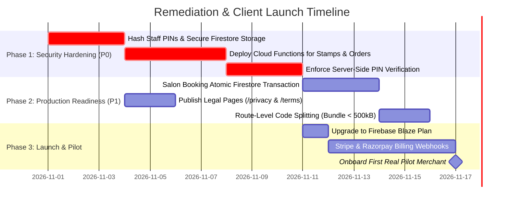

# PRIORITIZED IMPROVEMENT & REMEDIATION BACKLOG
**Project:** Loyaltydigitalqr  
**Audit Scope:** Comprehensive Engineering & Product Remediation Roadmap  
**Auditor:** Senior Principal Full-Stack & Security Architect (Antigravity Autonomous Pair Programmer)  
**Date of Audit:** October 31, 2026  
**Deliverable Path:** `audit/independent-readonly-audit/PRIORITIZED_IMPROVEMENT_BACKLOG.md`  

---

## 1. Prioritization Framework & Release Horizons

To turn Loyaltydigitalqr into a secure, robust, and client-ready SaaS platform, all findings have been categorized into four rigorous priority tiers across three delivery horizons:

- **P0 (Blocker — Immediate Critical Resolution):** Critical vulnerabilities that permit unauthorized data manipulation, credential leakage, or revenue distortion. Must be resolved before onboarding the first paying business.
- **P1 (High Priority — Production Launch Gate):** High-impact functional defects, race conditions, compliance gaps, and unverified flows that threaten operational integrity.
- **P2 (Medium Priority — Scalability & Reliability):** Performance bottlenecks, memory scaling, automated test harnesses, and missing confirmations.
- **P3 (Low Priority — Polish & Long-Term Enhancements):** Non-blocking UX polish, bundle optimizations, and advanced analytics expansions.

---

## 2. Priority P0 Backlog: Critical Security & Data Integrity Blockers

| Backlog ID | Issue Summary & Evidence | Potential Impact | Recommended Solution | Affected Files | Target Horizon |
| :---: | :--- | :--- | :--- | :--- | :---: |
| **P0-01** | **Plaintext Staff Counter PIN Storage** Evidence: `src/services/businessService.ts:82`; `src/types/business.ts:32` | Any workspace staff member can inspect plaintext counter validation PINs in DevTools or memory. | Strip `staffPin` from `businesses/{id}`. Store salted bcrypt hashes in a restricted document `businesses/{id}/private/security` (readable only by Owner). | `src/types/business.ts`, `src/services/businessService.ts`, `firestore.rules` | **Must Resolve Before First Client** |
| **P0-02** | **Client-Side Only Staff PIN Verification** Evidence: `src/services/loyaltyService.ts:436-440, 557-561` | `issueStamp` and `redeemReward` check PIN only if passed; omitting `staffPin` bypasses the check entirely. | Implement server-side verification in a Firebase Cloud Function. Mandate PIN verification on all counter stamp and redemption mutations. | `src/services/loyaltyService.ts`, new `functions/src/loyalty.ts` | **Must Resolve Before First Client** |
| **P0-03** | **Zero Authoritative Backend Mutation Layer** Evidence: Repository contains zero Cloud Functions (`src/`, `worker/`) | Malicious clients or compromised tokens can directly alter balances, totals, and records via Firebase JS SDK. | Deploy Firebase Cloud Functions for high-stakes operations: `issueStamp`, `redeemReward`, `createOrder`, and `bookAppointment`. | New `functions/` package, `firebase.json` | **Must Resolve Before First Client** |

---

## 3. Priority P1 Backlog: Major Functional Blockers & Compliance

| Backlog ID | Issue Summary & Evidence | Potential Impact | Recommended Solution | Affected Files | Target Horizon |
| :---: | :--- | :--- | :--- | :--- | :---: |
| **P1-01** | **Concurrent Salon Double-Booking Race Condition** Evidence: `src/services/salonService.ts:531-561` | Two customers booking the same stylist slot simultaneously will both succeed, creating conflicting appointments. | Wrap appointment booking in a server-side Firestore Transaction that asserts slot availability atomically before writing. | `src/services/salonService.ts`, new `functions/src/booking.ts` | **Must Resolve Before First Client** |
| **P1-02** | **Client-Side Order Pricing & Cart Tampering** Evidence: `src/services/orderService.ts:252-284`; `firestore.rules:265-267` | A modified client can submit cart items with arbitrary unit prices, writing unauthorized totals to Firestore. | Recalculate and assert order totals on the server using published `menuItems/{id}.price` before order confirmation. | `src/services/orderService.ts`, `firestore.rules` | **Must Resolve Before First Client** |
| **P1-03** | **Unrestricted Operational Collection Deletions by Staff** Evidence: `firestore.rules:186-195, 199-200` | In `firestore.rules`, any member can delete customer records or retail transactions via `write: if isMember(bizId)`. | Restrict `delete` permissions to `isManager(bizId)`. Enforce append-only immutable audit logs for staff. | `firestore.rules` | **Must Resolve Before First Client** |
| **P1-04** | **Dead Legal & Compliance Footer Links** Evidence: `src/components/common/Footer.tsx:183-191` | Privacy Policy, Terms of Service, and Cookie Preferences are non-clickable `` elements without routes. | Create dedicated routes (`/privacy`, `/terms`) with compliant disclosures for DPDP Act (India) and FTC/CCPA (USA). | `src/App.tsx`, `src/pages/PrivacyPolicyPage.tsx`, `src/pages/TermsPage.tsx`, `src/components/common/Footer.tsx` | **Must Resolve Before First Client** |
| **P1-05** | **Automated Payment Gateway Integration** Evidence: `README.md:58`; `src/components/dashboard/SettingsView.tsx:280` | Subscriptions are purely frontend display states without Stripe/Razorpay automated billing or renewal webhooks. | Integrate Stripe (for USA $10/mo) and Razorpay (for India ₹299/mo) with webhook Cloud Functions updating workspace status. | New `functions/src/billing.ts`, `src/services/businessService.ts` | **Resolve During Phase 5 Launch** |
| **P1-06** | **Real SMS & WhatsApp Communication Gateway** Evidence: `src/services/growthService.ts:562-564` | Win-back campaigns run as local simulations (CSV export only) without automated message dispatch. | Connect Twilio / WhatsApp Business API via Cloud Functions to allow merchants to send real marketing campaigns. | `src/services/growthService.ts`, new `functions/src/campaigns.ts` | **Resolve Post-Launch / V2** |

---

## 4. Priority P2 Backlog: Performance, Scalability & QA Infrastructure

| Backlog ID | Issue Summary & Evidence | Potential Impact | Recommended Solution | Affected Files | Target Horizon |
| :---: | :--- | :--- | :--- | :--- | :---: |
| **P2-01** | **Absence of Cursor Pagination in bizStore** Evidence: `src/lib/bizStore.ts:285-318` | All customers and historical records are loaded into client memory, causing high RAM usage for large businesses. | Implement server-side Firestore cursor pagination (`startAfter`, `limit`) and decouple CRM tables from full cache hydration. | `src/lib/bizStore.ts`, `src/services/loyaltyService.ts`, `src/components/dashboard/customers/CustomerCrmView.tsx` | **Resolve Post-Launch** |
| **P2-02** | **Lack of Modern Unit Testing Stack (Vitest)** Evidence: `package.json` contains zero unit test dependencies | Critical scheduling, pricing, and stamp algorithms lack automated unit tests in continuous integration. | Install `vitest` and `@testing-library/react`. Add unit tests for `salonScheduling.ts`, `dates.ts`, and `orderService.ts`. | `package.json`, `vite.config.ts`, new `tests/` | **Resolve During Phase 5** |
| **P2-03** | **Obsolete Puppeteer Verification Scripts** Evidence: `scripts/test-task2` through `test-task9` hardcode mock localStorage | Existing verification scripts fail against authenticated Firebase build, giving false failure reports in CI. | Archive legacy mock scripts into `scripts/archive/`. Author unified Playwright E2E suite targeting live preview server. | `scripts/` directory | **Resolve During Phase 5** |
| **P2-04** | **No Route-Level Code Splitting (1.88 MB Bundle)** Evidence: `npm run build` generates 1.88 MB JS chunk (`index-Do_h-Q29.js`) | Guests loading public menu on mobile connections download entire dashboard and all module views. | Implement React `lazy()` and `Suspense` for dashboard views and heavy public wizard routes. | `src/App.tsx`, `src/pages/DashboardPage.tsx` | **Resolve Before Client Launch** |
| **P2-05** | **Optimistic Cache Rollback on Batch Write Failure** Evidence: `src/lib/bizStore.ts:419-422, 471-475` | Rejected batch writes update in-memory state but do not roll back, showing optimistic state until browser reload. | Implement cache rollback on commit failure or invalidate affected collection cache immediately upon batch rejection. | `src/lib/bizStore.ts` | **Resolve During Phase 5** |

---

## 5. Priority P3 Backlog: Polish, Cleanup & Long-Term Enhancements

| Backlog ID | Issue Summary & Evidence | Potential Impact | Recommended Solution | Affected Files | Target Horizon |
| :---: | :--- | :--- | :--- | :--- | :---: |
| **P3-01** | **Duplicate Pricing Feature Bullet** Evidence: `src/pages/PricingSelectorPage.tsx:21-22` | Lines 21 and 22 render almost identical bullet points regarding smartphone browser compatibility. | Remove line 21 (`'Card works in any phone browser — no app'`). | `src/pages/PricingSelectorPage.tsx` | **Post-Audit Polish** |
| **P3-02** | **React 19 Impure Render Warnings** Evidence: `oxlint` warnings on `SettingsView.tsx`, `OverviewView.tsx` | Calling `Date.now()` during render violates React 19 compiler purity principles. | Move `Date.now()` evaluations into `useState` initializers or `useMemo` hooks. | `src/components/dashboard/SettingsView.tsx`, `src/components/dashboard/OverviewView.tsx` | **Post-Audit Polish** |
| **P3-03** | **Removal of Unreachable ModulePlaceholderView** Evidence: `src/components/dashboard/ModulePlaceholderView.tsx` | Redundant component containing outdated development task descriptions; only reachable via default branch. | Replace default switch case with `OverviewView` or 404 handler and archive `ModulePlaceholderView.tsx`. | `src/pages/DashboardPage.tsx`, `src/components/dashboard/ModulePlaceholderView.tsx` | **Cleanup Sprint** |
| **P3-04** | **Repository Artifact Archival (193 PNGs)** Evidence: 193 historical PNG screenshots in `audit/` bloat repository size | Git clone operations download unnecessary binary test artifacts (~40 MB). | Move historical evidence screenshots into an external release bundle or `.gitattributes` LFS store. | `audit/design-snapshots/`, `audit/pre-firebase/evidence/` | **Cleanup Sprint** |

---

## 6. Implementation Action Plan & Sequencing

