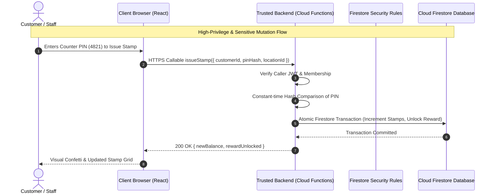

# SECURITY AND MULTI-TENANT DATA ISOLATION REPORT
**Project:** Loyaltydigitalqr  
**Audit Scope:** Deep Application Security, Multi-Tenant Boundary, RBAC & Data Isolation Review  
**Auditor:** Senior Principal Application Security & Database Architect (Antigravity Autonomous Pair Programmer)  
**Date of Audit:** October 31, 2026  
**Deliverable Path:** `audit/independent-readonly-audit/SECURITY_AND_DATA_ISOLATION_REPORT.md`  

---

## 1. Executive Security Evaluation & Threat Posture

Loyaltydigitalqr is designed as a multi-tenant Software-as-a-Service (SaaS) platform serving independent commercial establishments (cafés, salons, boutiques, fitness studios, car washes, and service businesses). In a multi-tenant architecture, **cross-tenant data leakage is catastrophic**: a business must never under any circumstances access, mutate, or enumerate another business's customers, revenue, operational queues, staff schedules, or proprietary settings.

### Summary Assessment
| Security Domain | Posture Rating | Key Architectural Reality |
| :--- | :---: | :--- |
| **Multi-Tenant Scoping (Firestore Rules)** | **STRONG** | Firestore rules strictly partition all collections under `/businesses/{bizId}/*` and mandate `request.auth.uid in bizData(bizId).memberUids`. Direct cross-business queries are strictly rejected by Firestore. |
| **Public Tracking Token Entropy** | **STRONG** | Orders and bookings use 32-character base-36 crypto-random identifiers (~160 bits entropy). Sequential order numbers are completely blocked from tracking lookups. |
| **Public Catalogue Sanitization** | **STRONG** | Public projections (`publicProfiles`, `memberCards`, `appointmentSlots`) systematically strip private customer notes, phone numbers, emails, and staff PINs. |
| **Cloudflare R2 Storage Isolation** | **STRONG** | Image upload credentials never touch the browser. Uploads are gated by a Cloudflare Worker verifying Firebase JWT and Firestore business membership. |
| **Staff Counter PIN Confidentiality** | **CRITICAL DEFECT (P0)** | 4-to-6 digit staff counter PINs are stored in **plaintext** inside the `businesses/{bizId}` document. All workspace members (including low-privilege receptionists and counter staff) receive these PINs in browser memory and DevTools. |
| **Client-Side Mutation Trust (No Cloud Functions)** | **CRITICAL DEFECT (P0)** | The application currently operates with **zero Cloud Functions or trusted backend layer**. All business logic (stamp calculations, reward unlocking, prices, discounts) runs in client JavaScript. Any authenticated member can directly write arbitrary values via the Firebase JS SDK. |
| **Client Role-Based Access Control (RBAC)** | **HIGH RISK (P1)** | While Firestore rules restrict `/config/*`, `/menus/*`, and `/settings` to Managers/Owners, all operational subcollections (`/customers/*`, `/orders/*`, `/retailPurchases/*`, `/gymMembers/*`, `/carwashPasses/*`) permit direct unrestricted write access to **any member** (`isMember(bizId)`). Low-privilege staff can delete or modify records. |

---

## 2. Multi-Business & Tenant Isolation Analysis

### A. Database Partitioning Model
The application utilizes a **subcollection-per-tenant** Firestore architecture:
```
/businesses/{businessId}                             [Private: Members Only]
  ├── /config/{docId}                                [Private: Managers Only (loyaltyProgram is public get)]
  ├── /customers/{customerId}                        [Private: Members Only (selfEnroll batch create)]
  │     └── (projected to) /memberCards/{customerId} [Public: Unguessable ID get]
  ├── /orders/{orderId}                              [Private: Members Only (Public get by unguessable ID)]
  ├── /appointments/{aptId}                          [Private: Members Only (Public get by unguessable ID)]
  │     └── (projected to) /appointmentSlots/{aptId} [Public: Times only, no customer PII]
  ├── /menus, /menuCategories, /menuItems, /tables   [Public: Read by guests; Write by managers]
  ├── /salonServices, /salonStaff                    [Public: Read by guests; Write by managers]
  ├── /retailCategories, /retailProducts             [Public: Read by guests; Write by managers]
  └── /gymMembers, /carwashPasses, /serviceJobs      [Private: Members Only]
```

### B. Verification of Multi-Tenant Boundaries
1. **Rule Enforcement:**  
   In `firestore.rules`:
   ```javascript
   function isMember(bizId) {
     return signedIn()
       && exists(/databases/$(database)/documents/businesses/$(bizId))
       && request.auth.uid in get(/databases/$(database)/documents/businesses/$(bizId)).data.memberUids;
   }
   ```
   Every member query requires `isMember(bizId)`. If User A (authenticated to Business 1) attempts to query `/businesses/biz_2/customers`, Firestore security rules evaluate `request.auth.uid in bizData('biz_2').memberUids` -> returns `false` -> triggers immediate `permission-denied`.
2. **Client-Side Cache Isolation (`bizStore.ts`):**  
   In `src/lib/bizStore.ts`, the in-memory cache maintains a separate `Map<string, AttachedBusiness>` keyed by `businessId`. When switching businesses, `businessService.setActiveBusiness()` calls `bizStore.detach(previousId)`, unsubscribing from all Firestore `onSnapshot` listeners and invalidating in-memory memoized bundles.
3. **Workspace Remounting:**  
   In `src/pages/DashboardPage.tsx`:
   ```tsx
   return <DashboardWorkspace key={active.id} {...props} currentUser={user} />;
   ```
   The React `key={active.id}` guarantees that the entire dashboard tree is unmounted and remounted upon switching businesses. No state, search queries, or form drafts bleed across workspaces.

---

## 3. Location Isolation Analysis

The platform supports multi-location operations for single businesses (e.g. downtown branch vs uptown branch).

### Current Implementation & Limitations:
1. **Location Storage:** Location definitions live in an array on the business document: `business.locations: BusinessLocation[]`.
2. **Active Location State:** In `src/services/businessService.ts`, the active location is persisted in browser `localStorage` under `loyalty_active_locations_map`.
3. **Operational Filtering:**
   - Orders queue: `orderService.getOrders(businessId, activeLocationId)` correctly filters orders assigned to the counter tablet's location.
   - Salon scheduling: `validateSlotAvailability()` checks staff assignment to the target location.
   - KDS Display: `KitchenDisplayPage.tsx` allows station operators to filter by location.
4. **Security Vulnerability:**  
   Firestore security rules do **not enforce location-level write authorization**. Any member can read or mutate records across all locations of the business. Location partitioning is an operational filter, not a security boundary. For small business operations with shared staff, this is standard; for franchise models, location-scoped custom claims would be required.

---

## 4. Deep Vulnerability Register

The following register details all confirmed security vulnerabilities, architectural trust defects, and compliance gaps identified during the audit:

| ID | Vulnerability Description | Severity | Source Evidence | Impact | Recommended Mitigation |
| :---: | :--- | :---: | :--- | :--- | :--- |
| **SEC-01** | **Plaintext Staff Counter PIN Storage** | **P0 (Critical)** | `src/services/businessService.ts:82`; `src/types/business.ts:32` | Counter validation PINs (`4821`, `randomPin()`) are stored unhashed on `businesses/{id}`. Any staff member can view PINs in DevTools or browser memory. | Hash PINs using bcrypt/scrypt. Never store plaintext PINs in Firestore documents accessible to the browser. |
| **SEC-02** | **Client-Side Only Staff PIN Verification** | **P0 (Critical)** | `src/services/loyaltyService.ts:436-440, 557-561` | `loyaltyService.issueStamp` only checks the PIN if `staffPin` is provided (`if (staffPin !== undefined && staffPin.trim().length > 0)`). Omitting `staffPin` bypasses the check entirely. | Move stamp issuance and voucher redemption to a trusted Cloud Function that enforces PIN verification server-side. |
| **SEC-03** | **Zero Trusted Backend Layer (No Cloud Functions)** | **P0 (Critical)** | Entire repository (`src/`, `worker/`) | Zero Cloud Functions exist. All document mutations (pricing, totals, stamps, balances) are executed directly from client browsers using `writeBatch()`. | Implement Firebase Cloud Functions for sensitive mutations (order creation, stamp issuance, reward redemption, booking confirmation). |
| **SEC-04** | **Unrestricted Operational Collection Writes by Staff** | **P1 (High)** | `firestore.rules:186-195, 199-200` | In `firestore.rules`, all operational subcollections allow `write: if isMember(bizId)`. Any receptionist or staff member can delete customer records or alter purchase totals. | Restrict delete and update permissions in Firestore rules to `isManager(bizId)`; use append-only event logs for staff actions. |
| **SEC-05** | **Client-Side Pricing & Discount Calculation** | **P1 (High)** | `src/services/orderService.ts:252-284`; `firestore.rules:265-267` | Firestore rules only assert `total == subtotal` and `total >= 0`. A modified client could send manipulated unit prices for cart items. | Cloud Function or Firestore Rule must validate item prices against published `menuItems/{id}.price`. |
| **SEC-06** | **Concurrent Double-Booking Race Condition** | **P1 (High)** | `src/services/salonService.ts:531-561` | Salon slot validation is evaluated against local in-memory snapshots. Two customers booking the same slot simultaneously will both succeed. | Wrap `createAppointment` in a Firestore Transaction or Cloud Function verifying that no overlapping `appointmentSlots` exist. |
| **SEC-07** | **Memory Bloat & Lack of Pagination in bizStore** | **P2 (Medium)** | `src/lib/bizStore.ts:285-318` | `bizStore` listens to the entire `/customers` collection without pagination. High-volume businesses (>2,000 customers) will experience heavy browser memory usage. | Implement server-side Firestore cursor pagination (`startAfter`, `limit`) and decouple CRM listing from full cache hydration. |
| **SEC-08** | **Optimistic Update Cache Desynchronization** | **P2 (Medium)** | `src/lib/bizStore.ts:419-422, 471-475` | If a Firestore batch write is rejected by security rules or network failure, `bizStore` logs the error but does not roll back in-memory state. | Implement cache rollback on commit failure or invalidate affected collection cache immediately upon batch rejection. |
| **SEC-09** | **Dead Legal & Compliance Links** | **P1 (High)** | `src/components/common/Footer.tsx:183-191` | Privacy Policy, Terms of Service, and Cookie Preferences in the footer are non-clickable `<span>` elements without route handlers. | Deploy dedicated `/privacy` and `/terms` routes before onboarding paying clients to comply with DPDP Act (India) and CCPA/FTC (USA). |
| **SEC-10** | **Simulated Marketing Labeling Clarity** | **P3 (Low)** | `src/services/growthService.ts:562-564` | Win-back campaigns run as local simulations without real message dispatch (CSV export only). | Maintain clear UI disclaimer that platform exports contact lists and does not provide an automated SMS/WhatsApp gateway. |

---

## 5. Public Endpoint Exposure & Data Leakage Review

An audit of all public endpoints accessible to unauthenticated guests confirms the following posture:

| Endpoint Route | Target Resource | Public Access Needs | Security Posture & Verified Behavior |
| :--- | :--- | :--- | :--- |
| `/menu/:slug` | Digital Menu & Tables | Menus, categories, items, tables | **SECURE**: Only loads published menu items and public business profile. Staff notes, internal finances, and CRM data are completely excluded. |
| `/order/:token` | Live Order Tracker | Single order by token | **SECURE**: Requires exact 32-character crypto-random token (`bizId.orderId`). Sequential lookups (`/order/1041`) return 404. Non-members cannot list orders. |
| `/book/:slug` | Public Booking Wizard | Services, staff, free slots | **SECURE**: Service and staff profiles are public. Slot calculation uses `appointmentSlots` which projects only start/end times without customer names or contact info. |
| `/appointment/:token` | Live Booking Tracker | Single booking by token | **SECURE**: Requires exact 32-character token. Customers can only view their own booking and submit status updates to `'cancelled'`. |
| `/catalog/:slug` | Boutique Lookbook | Retail categories & products | **SECURE**: Public read of published products and variants. In-store purchasing only; no payment credentials or customer records exposed. |
| `/card/:slug` | Loyalty Card Join | Loyalty rule & join form | **SECURE**: Reads only public loyalty program rule. Customer self-enrollment batch writes uniqueness phone index preventing duplicate signups. |
| `/card/:slug/:id` | Live Customer Card | Customer's own stamp card | **SECURE**: Reads `/memberCards/{id}` projection. Contains only firstName, current stamps, lifetime visits, and reward vouchers. Staff notes, email, and phone are excluded. |

---

## 6. Recommended Security Remediation Architecture

To achieve enterprise-grade security suitable for paying clients, the following backend architecture is required:



### Immediate Action Plan:
1. **Remove Plaintext PINs:** Strip `staffPin` from `businesses/{id}.locations`. Store salted bcrypt hashes in a restricted subcollection `businesses/{id}/private/security` (readable only by Owner).
2. **Deploy Callable Functions:** Create Cloud Functions for `issueLoyaltyStamp`, `redeemRewardVoucher`, and `createOrder`.
3. **Audit Event Immutability:** Enforce in Firestore rules that documents in `businesses/{id}/loyaltyEvents` can only be created, never updated or deleted.
