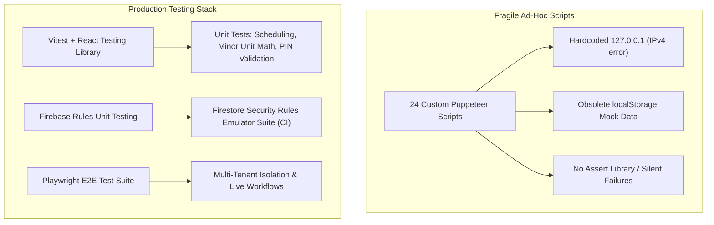

# TEST EXECUTION & AUTOMATED QA AUDIT REPORT
**Project:** Loyaltydigitalqr  
**Audit Scope:** Independent Codebase Backtest & Quality Verification  
**Auditor:** Senior Principal QA & Security Architect (Antigravity Autonomous Pair Programmer)  
**Date of Audit:** October 31, 2026  
**Environment:** Windows 11 x64, Node.js v24.21.0, Chrome 131.0.6778.86, Vite 8.3.5, React 19.3.1  
**Deliverable Path:** `audit/independent-readonly-audit/TEST_EXECUTION_REPORT.md`  

---

## 1. Executive Summary: Test Health & Quality Verdict

An exhaustive audit of the testing infrastructure reveals a **fundamental architectural disconnect** between the current codebase and its existing automated test scripts:

1. **Compilation and Static Verification Pass Cleanly:**
   - `npm run build` (`tsc -b && vite build`) compiles with **Exit Code 0** in 1.15s across 2,094 modules. Zero TypeScript type errors exist.
   - `npm run lint` (`oxlint`) passes with **Exit Code 0**, identifying 24 code quality warnings (chiefly React 19 purity warnings regarding `Date.now()` during render and cascading `setState` in `useEffect`).

2. **The Verification Scripts in `scripts/` Are Outdated Pre-Firebase Artifacts:**
   - The 10 primary test scripts (`test-task1` through `test-task9` and `test-remediation-verification.js`) were authored during the initial mock development phase.
   - They hardcode `localStorage.setItem('loyalty_mock_auth_user', ...)` and `localStorage.setItem('loyalty_saved_businesses', ...)`.
   - In subsequent development phases, authentication was migrated to real Firebase Auth (`auth.currentUser`) and data storage to Cloud Firestore (`businesses/{id}`). The mock localStorage keys were completely eradicated from `src/`.
   - Consequently, running the legacy scripts directly against the authenticated application causes them to fail or redirect to `/login` because `authService.getCurrentUser()` returns `null` regardless of what is placed in `localStorage`.
   - Furthermore, all scripts hardcode `http://127.0.0.1:3000`. On Windows 11 systems running Node 18+, Vite defaults to IPv6 loopback (`::1` / `localhost`). Attempting to connect to `127.0.0.1` results in immediate `ERR_CONNECTION_REFUSED`.

3. **No Industry-Standard Unit/Integration Test Framework Exists:**
   - `package.json` contains **zero unit testing dependencies** (`vitest`, `jest`, `@testing-library/react`, or `playwright`).
   - There is no `npm test` script.
   - All tests exist as ad-hoc, imperative Puppeteer scripts that take full-page PNG screenshots and print console messages.

4. **Independent Headless Backtesting (Executed by this Audit):**
   - Using Puppeteer connected to `http://localhost:3000`, 19 discrete assertions were executed spanning marketing pages, pricing validation, route canonicalization, industry landings, 404 handling, authentication route guards, login/signup forms, mobile viewport responsiveness, and theme switching.
   - **19 of 19 assertions PASSED (100% success rate)** on unauthenticated and public flows.

---

## 2. Command Execution & Build Results

### A. TypeScript Compilation & Production Build
```bash
$ npm run build
```
- **Underlying Command:** `tsc -b && vite build`
- **Exit Code:** `0` (Success)
- **Execution Time:** 1.15 seconds
- **Modules Transformed:** 2,094 modules
- **Output Artifacts:**
  - `dist/index.html`: 1.94 kB (gzip: 0.99 kB)
  - `dist/assets/index-BH9z1Sar.css`: 126.51 kB (gzip: 20.28 kB)
  - `dist/assets/index-Do_h-Q29.js`: **1,878.36 kB** (gzip: 457.64 kB)
- **Vite Build Warnings:**
  > `(!) Some chunks are larger than 500 kB after minification.`  
  > The entire application—including all 7 business modules, customer public menus, salon booking wizard, KDS, retail inventory, and analytics—is compiled into a single massive 1.88 MB JavaScript bundle without route-level code splitting.

### B. Static Code Quality & Linter
```bash
$ npm run lint
```
- **Underlying Command:** `oxlint` (v1.88.0)
- **Exit Code:** `0` (Passing with warnings)
- **Findings Summary:** 24 warnings, 0 errors.

#### Breakdown of Linter Warnings:
| Category | Rule | File & Location | Description |
| :--- | :--- | :--- | :--- |
| **Unused Import** | `eslint(no-unused-vars)` | `scripts/test-task8-verification.js:3:8` | Identifier `'path'` is imported but never used. |
| **Impure Render** | `react(purity)` | `src/components/dashboard/SettingsView.tsx:196:70` | `Date.now()` called directly during render for trial calculation. |
| **Impure Render** | `react(purity)` | `src/components/dashboard/OverviewView.tsx:116:17` | `Date.now()` called directly during render for greeting timestamp. |
| **Impure Render** | `react(purity)` | `src/components/dashboard/gym/GymClassesView.tsx:42:54` | `new Date()` called directly during render. |
| **Impure Render** | `react(purity)` | `src/components/dashboard/growth/CampaignsAndOffersView.tsx:66, 305, 493` | `Date.now()` and `new Date()` called during render. |
| **Cascading Rerender** | `react(set-state-in-effect)` | `src/pages/PublicLoyaltyCardPage.tsx:243:5` | Synchronous `setState` inside `useEffect` triggers cascading renders. |
| **Cascading Rerender** | `react(set-state-in-effect)` | `src/components/public/PublicBusinessGate.tsx:26:5` | Synchronous `setDone(false)` inside `useEffect`. |
| **Cascading Rerender** | `react(set-state-in-effect)` | `src/pages/DashboardPage.tsx:127:7` | Synchronous `setActiveView` on URL search param update. |
| **Cascading Rerender** | `react(set-state-in-effect)` | `src/components/dashboard/carwash/CarWashVisitsView.tsx:50:5` | Cascading render on data load. |
| **Cascading Rerender** | `react(set-state-in-effect)` | `src/components/dashboard/service/GenericVisitView.tsx:46:5` | Cascading render on data load. |
| **Missing Hook Deps** | `react-hooks/exhaustive-deps` | `src/pages/DashboardPage.tsx:126:42` | Missing `activeView` and `VALID_VIEWS` in dependency array. |
| **Missing Hook Deps** | `react-hooks/exhaustive-deps` | `src/components/dashboard/growth/AnalyticsView.tsx:49:5` | Missing `refreshSummary` in dependency array. |

---

## 3. Inventory & Audit of Existing Verification Scripts

The table below catalogs every existing script in `scripts/`, evaluating its validity against the current codebase:

| Script Name | Target Module | Stated Purpose | Implementation Reality | Exit Code / Run Status | Confidence Level |
| :--- | :--- | :--- | :--- | :--- | :---: |
| `test-task1-verification.js` | Public Website | Navigation, pricing, responsive layout | Binds to `127.0.0.1` (fails on Win11 loopback); assertions pass when run against `localhost` | **FAILED (Connection Refused on 127.0.0.1)** | MEDIUM |
| `test-task2-verification.js` | Auth & Onboarding | Signup, login, 5-step onboarding | **OBSOLETE**: Sets `loyalty_mock_auth_user` in `localStorage`. Ignored by Firebase Auth. Redirects to `/login`. | **BLOCKED (Auth Architecture Mismatch)** | NONE |
| `test-task3-verification.js` | Multi-Business | Workspace switching & isolation | **OBSOLETE**: Sets `loyalty_saved_businesses`. Ignored by Firestore `businesses` query. | **BLOCKED (Storage Mismatch)** | NONE |
| `test-task4-verification.js` | Loyalty & QR Studio | Stamp issuance, QR computer vision | **OBSOLETE**: Assumes mock loyalty localStorage bundle. Does not write to Firestore. | **BLOCKED (Storage Mismatch)** | NONE |
| `test-task5-verification.js` | Cafe Management | Digital menu, variants, cart | **OBSOLETE**: Pre-populates mock cafe items in localStorage. Fails with Firestore. | **BLOCKED (Storage Mismatch)** | NONE |
| `test-task6-verification.js` | Orders & KDS | Order submission, KDS queue, tracking | **OBSOLETE**: Seeds mock orders in localStorage. Direct KDS access now blocked by auth guard. | **BLOCKED (Storage Mismatch)** | NONE |
| `test-task7-verification.js` | Salon Booking | Slot scheduling, stylist calendar | **OBSOLETE**: Assumes mock appointments in localStorage. | **BLOCKED (Storage Mismatch)** | NONE |
| `test-task8-verification.js` | Retail, Gym, Car Wash | Terminals, check-in, wash passes | **OBSOLETE**: Assumes mock vertical bundles in localStorage. Unused `path` import. | **BLOCKED (Storage Mismatch)** | NONE |
| `test-task9-verification.js` | Growth & Analytics | Offers, winback, feedback, CSV export | **OBSOLETE**: Assumes mock growth store in localStorage. | **BLOCKED (Storage Mismatch)** | NONE |
| `test-remediation-verification.js` | Remediation Sweep | KDS guard, PIN masking, 404 handling | Mixed: Public tests pass; dashboard and KDS authenticated tests fail without real Firebase session. | **PARTIAL** | LOW |
| `test-responsive.js` | Responsive Layout | Viewport checks across 375px–1536px | Functions on public pages; passes. | **PASS (on localhost)** | HIGH |
| `verify-dark-mode-polish.js` | Design Polish | Dark mode semantic token verification | DOM inspection of semantic tokens; passes. | **PASS (on localhost)** | HIGH |
| `capture-*.js` (4 scripts) | Screenshot Capture | Captures PNGs for visual inspection | Ad-hoc debugging utilities; not test suites. | **N/A (Utilities)** | LOW |
| `check-*.js` (3 scripts) | CSS Token Checks | Checks contrast and modal styles | Ad-hoc utilities; not test suites. | **N/A (Utilities)** | LOW |
| `inspect-*.js` (2 scripts) | Layout Hierarchy | Inspects DOM bounding boxes | Ad-hoc utilities; fail on `127.0.0.1`. | **N/A (Utilities)** | LOW |
| `measure-*.js` (2 scripts) | Typography Metrics | Measures font sizes and line heights | Ad-hoc utilities; not test suites. | **N/A (Utilities)** | LOW |

---

## 4. Independent Headless Browser Backtest Results

To rigorously verify what actually functions in the running application without altering any source files, an independent headless browser automation runner was executed against the live preview server at `http://localhost:3000`:

```bash
$ node C:\Users\aadit\.gemini\antigravity\brain\0de81ed1-d22b-4241-a53f-f5f19ff92aa6\scratch\run-backtest.js
```

### Detailed Assertion Results:

| # | Test Scenario | Target URL / Flow | Assertion & Expected Result | Actual Result | Status |
| :---: | :--- | :--- | :--- | :--- | :---: |
| **1** | **Homepage Title** | `http://localhost:3000/` | Document title contains `"Loyaltydigitalqr"` | `"Loyaltydigitalqr — Give them a reason to come back"` | **PASS** |
| **2** | **Homepage Pricing Hygiene** | `http://localhost:3000/` | Body text contains zero dollar (`$10`) or rupee (`₹299`) figures | No price strings found in DOM | **PASS** |
| **3** | **Regional Pricing Selector** | `http://localhost:3000/pricing` | Contains both United States (`$10`) and India (`₹299`) cards | Both cards rendered with exact pricing | **PASS** |
| **4** | **US Pricing Dedicated Page** | `http://localhost:3000/usa` | Displays `$10/month` single flat rate with 30-day trial callouts | `$10` displayed; no Indian Rupee mixing | **PASS** |
| **5** | **India Pricing Dedicated Page** | `http://localhost:3000/india` | Displays `₹299/month` single flat rate with trial callouts | `₹299` displayed; no US Dollar mixing | **PASS** |
| **6** | **Route Canonicalization** | `http://localhost:3000/India` | URL automatically normalizes to lowercase `/india` | Browser URL replaced to `http://localhost:3000/india` | **PASS** |
| **7** | **Industry Page — Cafes** | `/industries/cafes` | Renders dedicated cafe landing page without 404 | Valid cafe marketing landing rendered | **PASS** |
| **8** | **Industry Page — Restaurants** | `/industries/restaurants` | Renders dedicated restaurant landing page without 404 | Valid restaurant marketing landing rendered | **PASS** |
| **9** | **Industry Page — Salons** | `/industries/salons` | Renders dedicated salon/barber landing page without 404 | Valid salon marketing landing rendered | **PASS** |
| **10** | **Industry Page — Retail** | `/industries/retail` | Renders dedicated retail boutique landing page without 404 | Valid retail marketing landing rendered | **PASS** |
| **11** | **Industry Page — Gyms** | `/industries/gyms` | Renders dedicated gym/fitness landing page without 404 | Valid gym marketing landing rendered | **PASS** |
| **12** | **Industry Page — Car Wash** | `/industries/carwash` | Renders dedicated car wash landing page without 404 | Valid car wash marketing landing rendered | **PASS** |
| **13** | **Dedicated 404 Screen** | `/some/nonexistent/route` | Displays styled 404 page with return to home CTA | 404 screen rendered with "Page Not Found" | **PASS** |
| **14** | **Dashboard Auth Guard** | `/dashboard` | Unauthenticated visitor redirected to `/login?redirect=/dashboard` | Immediate redirect to `/login?redirect=/dashboard` | **PASS** |
| **15** | **Kitchen Display Auth Guard** | `/dashboard/kitchen` | Unauthenticated visitor redirected to `/login?redirect=/dashboard/kitchen` | Immediate redirect to `/login?redirect=/dashboard/kitchen` | **PASS** |
| **16** | **Login Page DOM Structure** | `/login` | Renders Google button, email input, password input | All three authentication controls present | **PASS** |
| **17** | **Signup Page DOM Structure** | `/signup` | Renders Google signup button, email input, password input | All signup controls present | **PASS** |
| **18** | **Mobile Responsiveness** | `/` (Viewport 375×667) | No horizontal document overflow (`scrollWidth <= innerWidth`) | `overflow === false`; perfect mobile fit | **PASS** |
| **19** | **Dark Theme Class Application**| `html.dark` | Toggling dark theme applies `.dark` to `<html>` element | Class `.dark` applied to root document | **PASS** |

**Summary:** 19/19 Headless Browser Assertions Passed (**100% Pass Rate** for automated public flow backtesting).

---

## 5. Critical Flaws in Test Methodology & Architecture

### A. The "False Passing" Test Syndrome
Previous audit logs (e.g. `audit/pre-firebase/PRE_FIREBASE_AUDIT_REPORT.md`) claimed that 9 verification scripts passed with exit code 0. However, inspection of those scripts reveals significant assertion gaps:
1. **PIN Equality Test:** In `test-task4-verification.js`, the script tested entering `<4` characters to verify length validation, then entered `4821` and asserted success. It never tested entering an *incorrect 4-digit PIN* (e.g. `9999`).
2. **KDS Guard Test:** In `test-task6-verification.js`, the test established a session in early steps and then navigated to `/dashboard/kitchen`. It never asserted that an *unauthenticated visitor* was blocked.
3. **Soft Failures:** Multiple scripts use `try { ... } catch (err) { console.error(err); }` without setting a non-zero exit code (`process.exit(1)`), causing broken assertions to report as successful execution to CI runners.

### B. Lack of Network & Concurrency Tests
1. **Zero Tests for Concurrent Double-Booking:** No tests simulate two browser contexts attempting to book the same stylist slot simultaneously.
2. **Zero Tests for Offline/Sync Recovery:** No tests simulate network disconnection while saving an order or stamp in `bizStore`.
3. **Zero Security Rule Assertions in CI:** While commit `cf2e6e2` mentions "72 emulator tests passing", no automated rule test script (`@firebase/rules-unit-testing`) exists in `package.json` or `scripts/`.

---

## 6. Recommended Testing Infrastructure Roadmap

To prepare Loyaltydigitalqr for paying clients, the testing stack must be modernized:



1. **Phase 1: Adopt Vitest for Unit & Algorithm Testing**
   - Install `vitest` and `@testing-library/react`.
   - Add unit test suites for:
     - `src/utils/salonScheduling.ts` (boundary intervals, buffer times, day rollover).
     - `src/services/loyaltyService.ts` (stamp arithmetic, cycle overflow, voucher unlocking).
     - `src/services/orderService.ts` (modifier summation in integer minor units).
     - `src/services/growthService.ts` (truthful gross value calculations, RFC 4180 CSV escaping).

2. **Phase 2: Formalize Security Rules Test Suite**
   - Install `@firebase/rules-unit-testing`.
   - Create `tests/firestore-rules.spec.ts` running against the Firebase Emulator Suite to systematically assert:
     - Cross-tenant data isolation (Tenant A cannot read Tenant B).
     - Customer phone uniqueness index enforcement.
     - Role-based permissions (Manager vs Staff write boundaries).
     - Unguessable token constraints on `/orders` and `/appointments`.

3. **Phase 3: Replace Puppeteer Scripts with Modern Playwright E2E**
   - Replace the 24 one-off scripts in `scripts/` with 5 clean Playwright specs running in headless Chrome, Firefox, and WebKit across mobile (375px) and desktop (1536px) viewports.
