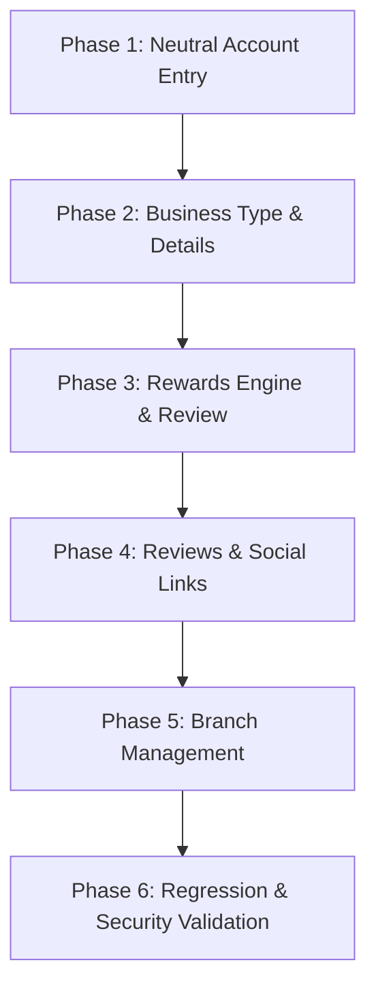

# Recommended Phased Implementation Plan

**Audit Reference:** `audit/onboarding-social-branches-audit/`  
**Target Repository:** Loyaltydigitalqr  
**Execution Rule:** Plan only — no code modifications are made during this audit phase.

---

## 1. Overview and Implementation Strategy

To deliver the proposed customer onboarding, rewards configuration, social engagement, and multi-branch management experience safely and with zero regression across existing industry verticals, implementation must follow a strict 6-phase sequence.

---

## 2. Detailed Phase Specifications

### Phase 1: Neutral Account Entry Experience

#### Scope
- Strip all country-specific pricing callouts, query-parameter branching, and regional plan switchers from `/signup` and `/login`.
- Update signup headline and eyebrow to communicate a neutral, welcoming "Start your free trial".
- Preserve full Google and Email/Password authentication workflows and email verification gate.
- Ensure public pricing pages (`/pricing`, `/usa`, `/india`) retain their detailed market pricing.

#### Files Involved
- **Existing Files:**
  - `src/pages/SignupPage.tsx`
  - `src/pages/LoginPage.tsx`
  - `src/services/authService.ts`
  - `src/router/Router.tsx`
- **New Files:** None.

#### Data Model & Firebase Implications
- Remove `region` dependency from initial signup draft creation.
- Keep `users/{uid}` profile recording unchanged.

#### Risks & Mitigations
- *Risk:* Breaking query-param based entry from marketing ads (`?region=india`).
- *Mitigation:* Gracefully ignore or store the region in draft as a hint, but do not display pricing or restrict signup.

#### Acceptance Criteria
- Signing up via Google or Email presents identical, neutral UI regardless of URL query parameters.
- No dollar ($) or rupee (₹) signs appear on `/signup` or `/login`.
- Successful signup smoothly transitions to `/onboarding` Step 2.

---

### Phase 2: Business Type Selection & Business Details

#### Scope
- Redesign Onboarding Step 1 & 2 into two distinct, focused steps:
  - **Step 2 (Business Type):** 12 easy-to-understand visual category cards (Coffee shops, Restaurants, Bakeries, Hair salons/barbers, Beauty salons, Nail salons, Spas, Wellness centres, Gyms, Retail stores, Car wash, Other).
  - **Step 3 (Business Details):** Business name input, optional logo upload with initials fallback, Country selector automatically deriving Currency (INR ₹, USD $, GBP £, EUR €, etc.). Timezone is completely hidden from UI and derived internally.
- Eliminate the legacy "Choose Modules" step from onboarding (modules remain configurable in dashboard).
- For businesses selecting "Other", integrate initial service catalogue configuration.

#### Files Involved
- **Existing Files:**
  - `src/pages/OnboardingPage.tsx`
  - `src/types/onboarding.ts`
  - `src/data/onboardingData.ts`
  - `src/services/businessService.ts`
  - `src/services/genericService.ts`
  - `src/lib/uploads.ts`
- **New Files:**
  - `src/components/onboarding/BusinessTypeCards.tsx` (optional extracted component)
  - `src/data/countriesData.ts` (mapping of countries to ISO currencies and default timezones)

#### Data Model & Firebase Implications
- Extend `BusinessType` or add `subCategory` field mapping back to the 7 core engine types.
- Ensure `businessService.createBusiness()` receives the derived `timeZone` and `currency`.

#### Risks & Mitigations
- *Risk:* Hiding timezone breaks appointment scheduling or date boundary calculations.
- *Mitigation:* Derive `timeZone` using `Intl.DateTimeFormat().resolvedOptions().timeZone` or the country's primary timezone, storing it in `Business` exactly as before.

#### Acceptance Criteria
- Business type selection displays all 12 categories cleanly on mobile and desktop.
- Selecting a country instantly displays the correct currency symbol without showing subscription prices.
- No timezone dropdown or text is visible on the onboarding screen.

---

### Phase 3: Customer Reward Configuration & Final Review Card

#### Scope
- Redesign Onboarding Step 4:
  - Number of visits / stamps required (preset buttons + custom number input).
  - Reward type selector: Free item, Percentage discount, Fixed amount off, Custom reward.
  - Value or description input with appropriate currency symbol.
  - Reward expiry selector: Default "Never expires" with selectable options (30, 60, 90, 180, 365 days).
- Redesign Onboarding Step 5:
  - Comprehensive Final Review Card summarizing all configured data.
  - "Edit" back-navigation to earlier steps without data loss.
  - Idempotent submit handling: disable button during `isSubmitting` to prevent duplicate workspace creation.
- Update Settings Loyalty Tab in the dashboard to support editing structured reward types and expiry.

#### Files Involved
- **Existing Files:**
  - `src/pages/OnboardingPage.tsx`
  - `src/components/onboarding/LoyaltyCardPreview.tsx`
  - `src/components/dashboard/SettingsView.tsx`
  - `src/services/loyaltyService.ts`
  - `src/types/loyalty.ts`
- **New Files:** None.

#### Data Model & Firebase Implications
- Add `rewardType`, `rewardValue`, and `expiryDays` to `businesses/{bizId}/config/loyaltyProgram`.
- Add `expiresAt` calculation to `CustomerReward` when stamps unlock a voucher (`loyaltyService.ts#L520`).

#### Risks & Mitigations
- *Risk:* Editing reward settings invalidates existing customer stamp progress or existing unredeemed rewards.
- *Mitigation:* Keep existing customers' `currentStamps` intact; existing rewards snapshot their terms at unlock time and are not overwritten.

#### Acceptance Criteria
- Owner can select "Never expires" or a specific validity duration.
- Changing reward configuration from the dashboard does not alter existing issued customer vouchers.
- The review card reflects all choices accurately and creates the workspace atomically.

---

### Phase 4: Reviews, Social Links & Click Analytics

#### Scope
- Dashboard Settings: Add dedicated "Reviews & Social" section.
- Enable independent configuration and toggling for:
  - Google Review destination URL.
  - Instagram profile URL.
  - TikTok profile URL.
- Public Card: Render enabled social pill buttons on `PublicLoyaltyCardPage.tsx` with mobile touch targets and secure external link handling (`rel="noopener noreferrer"`).
- Click Tracking: Track clicks on social links to a scoped Firestore subcollection `businesses/{bizId}/socialClicks` with client debouncing.
- Analytics: Display tap/click counts in `AnalyticsView.tsx` with date-range filters (`7d`, `30d`, `90d`, `all`).
- Accurate Copy: Explicitly label metrics as "Link Taps" / "Clicks" (no false claims of reviews or follows).

#### Files Involved
- **Existing Files:**
  - `src/types/business.ts`
  - `src/services/businessService.ts`
  - `src/components/dashboard/SettingsView.tsx`
  - `src/pages/PublicLoyaltyCardPage.tsx`
  - `src/components/dashboard/growth/AnalyticsView.tsx`
  - `src/services/growthService.ts`
  - `firestore.rules`
- **New Files:**
  - `src/services/socialAnalyticsService.ts` (optional modular click service)

#### Data Model & Firebase Implications
- Add `socialLinks` to `Business` and mirror enabled links to `publicProfiles/{bizId}`.
- Add `businesses/{bizId}/socialClicks/{clickId}` subcollection and corresponding security rule in `firestore.rules`.

#### Risks & Mitigations
- *Risk:* Malicious or bot traffic spamming click events.
- *Mitigation:* Client-side session debouncing in `localStorage` + strict Firestore security rule schema validation.

#### Acceptance Criteria
- Toggling off Instagram removes it from the public card while preserving the saved URL in settings.
- Clicking Google Review on the public card opens the link in a new tab and increments the dashboard click metric.
- UI never claims clicks represent verified reviews.

---

### Phase 5: Multi-Branch & Location Management

#### Scope
- Formalize branch lifecycle management in `SettingsView.tsx` under Locations:
  - Add new branch / location.
  - Edit location name, address, phone number, and staff PIN.
  - Soft deactivation / archiving (`status: 'archived'`) instead of destructive deletion.
- Verify cross-branch loyalty continuity (customers collect stamps across all branches under one business account).
- Add location filter to `AnalyticsView.tsx` allowing metrics to be viewed business-wide or filtered by branch.

#### Files Involved
- **Existing Files:**
  - `src/types/business.ts`
  - `src/services/businessService.ts`
  - `src/components/dashboard/SettingsView.tsx`
  - `src/components/dashboard/BusinessSwitcherModal.tsx`
  - `src/components/dashboard/growth/AnalyticsView.tsx`
  - `src/services/growthService.ts`
- **New Files:** None.

#### Data Model & Firebase Implications
- Extend `BusinessLocation` with `status: 'active' | 'archived'`, `phoneNumber?: string`.
- Update `toPublicProfile` to exclude archived branches.

#### Risks & Mitigations
- *Risk:* Archiving a branch breaks historical audit events referencing that branch ID.
- *Mitigation:* Soft archiving preserves the location in the data structure while hiding it from active switchers.

#### Acceptance Criteria
- Owner can add, edit, and archive branches without losing historical data.
- Switching branches in the dashboard updates the active location context.
- Customer loyalty stamps work seamlessly across all branches of the same business.

---

### Phase 6: Final Regression & Security Validation

#### Scope
- Complete regression verification across all existing industry verticals:
  - Café/Restaurant: Menu, Table QR codes, Online Ordering, Kitchen Display System.
  - Salon: Services, Staff availability, Appointments, Calendar.
  - Retail: Catalogue, lookbook, in-store sales.
  - Gym: Members, Check-in terminal, Studio classes.
  - Car Wash: Wash services, Prepaid bundles, Pass redemption.
  - Generic Services: Services catalogue, job logging, public storefront.
- Firestore Security Rules audit: verify that no rule leaks private business data or allows unauthenticated writes outside permitted paths.
- Build & Lint check: `tsc -b --noEmit` and `oxlint`.

#### Files Involved
- All application and audit files.

#### Acceptance Criteria
- Zero regression in existing café, salon, retail, gym, carwash, or generic service workflows.
- Clean TypeScript compilation and zero linting errors.
- Firestore rules validated against unauthorized access.
